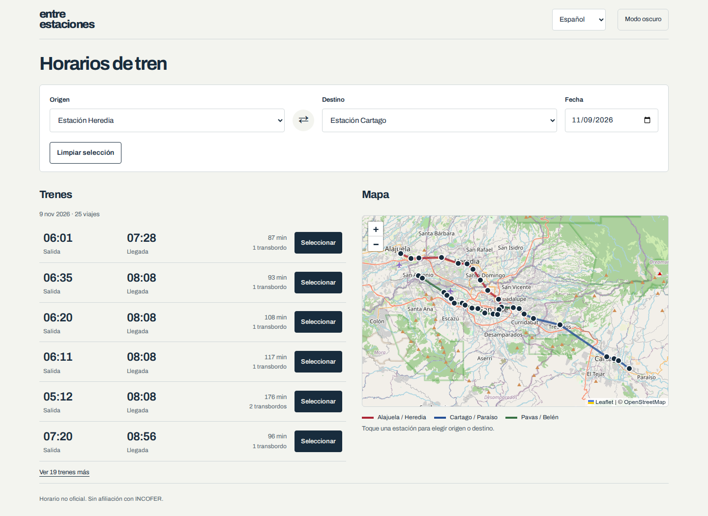

<h1 align="center">Entre estaciones</h1>
<p align="center">Trenes y transbordos en Costa Rica.</p>



Seleccione origen, destino y fecha para consultar los trenes del día. El planificador calcula los transbordos y muestra el recorrido en el mapa. Disponible en español e inglés, con temas claro y oscuro.

> Horario no oficial. La vigencia de las imágenes de referencia no está confirmada.

## Inicio rápido

Requiere Node.js 22.18 o superior y pnpm 12.16.1.

```bash
pnpm install --frozen-lockfile
pnpm start
```

Abra [localhost:4173](http://localhost:4173). Para comprobar los cambios, ejecute `pnpm test` y `pnpm build`.

## Documentación

- [Desarrollo y pruebas](docs/guias/desarrollo.md)
- [Publicación en GitHub Pages](docs/guias/publicacion.md)
