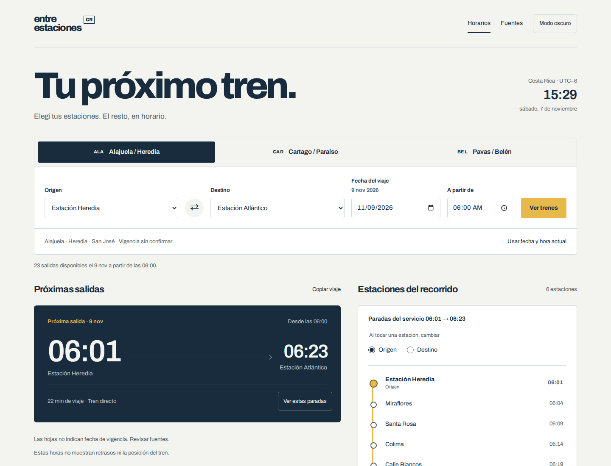

<h1 align="center">Entre estaciones</h1>
<p align="center">Tu próximo tren en Costa Rica, con sus horas y paradas publicadas.</p>



Una guía independiente para consultar trenes de **Alajuela, Heredia, San José, Cartago, Paraíso, Pavas y Belén**. Elegís el corredor, las estaciones, la fecha y la hora; el planificador muestra los servicios directos que tienen parada publicada en ambos extremos.

> **Horarios publicados, sin seguimiento en vivo.** Las imágenes de referencia no indican fecha de vigencia. Confirmá cambios, feriados y tarifas con [INCOFER](https://www.incofer.go.cr/) antes de viajar.

## El viaje, de un vistazo

- **La próxima salida primero.** Hora de salida, llegada y duración, seguidas por los demás servicios disponibles.
- **Cada tren tiene sus paradas.** Seleccioná una salida para ver sus horas en el diagrama; podés cambiar origen o destino desde las estaciones.
- **El día importa.** Zona horaria `America/Costa_Rica`, fines de semana sin servicio regular y búsqueda del próximo día hábil cuando ya pasó el último tren.
- **Un enlace para tu viaje.** Copiá la consulta con estaciones, fecha y hora, y volvé a abrirla con esos mismos valores.
- **Claro u oscuro.** Ambos temas funcionan en teléfono, tableta y escritorio, con controles de teclado y movimiento reducido.

Las capturas muestran una consulta de ejemplo para el **9 de noviembre de 2026 a las 06:00**, no una salida en tiempo real.

## Los recorridos

| Corredor | Estaciones | Servicios en ambos sentidos |
| --- | ---: | ---: |
| Alajuela / Heredia / San José | 13 | 46 |
| San José / Cartago / Paraíso | 10 | 28 |
| Curridabat / San José / Pavas / Belén | 18 | 20 |
| **Total** | | **94** |

Los servicios parciales conservan sus extremos originales. Una celda ausente significa que no hay hora publicada para esa estación; no se interpolan paradas. Las tarifas se muestran únicamente para las parejas de estaciones impresas en las hojas.

## Probar en local

Necesitás **Python 3** para servir los archivos. La aplicación no requiere instalación de dependencias ni compilación.

```bash
python3 -m http.server 4173 --bind 127.0.0.1
```

Abrí **[localhost:4173](http://localhost:4173)**. También podés usar `npm start`. Usá un servidor HTTP: abrir `index.html` con `file://` no permite cargar los módulos.

## Comprobar los cambios

Las pruebas de horarios y búsqueda necesitan **Node.js 22 o superior**, sin paquetes adicionales:

```bash
node --test tests/*.test.mjs
```

Para verificar la interfaz, dejá el servidor local encendido en otra terminal:

```bash
npm ci
npx playwright install chromium
npm run test:browser
```

La prueba de navegador cubre los tres corredores, ambos sentidos, fechas y casos sin servicio, selección de paradas, enlace compartido, temas, teclado, movimiento reducido, fallos de carga y tamaños de 320 a 1920px. Ejecuta axe para WCAG AA y guarda las capturas en `.shots/`.

Para otro servidor: `TEST_URL=http://127.0.0.1:4400 npm run test:browser`. Si ya tenés un Chromium compatible, podés indicar `PLAYWRIGHT_CHROMIUM_EXECUTABLE_PATH`.

## Dentro del proyecto

```text
index.html              Planificador y estados de carga
app.mjs                 Interacciones, resultados y diagrama
styles.css              Sistema visual y adaptación a pantallas
theme.js                Tema del sistema y preferencia local
map.mjs                 Mapa geográfico de carga opcional
lib/journeys.mjs         Búsqueda directa y calendario de servicio
data/schedules.mjs      Horarios y tarifas transcritos
data/sources/           Las cinco hojas de referencia originales
fuentes.html            Procedencia, límites y acceso a las imágenes
tests/                  Pruebas de datos, búsquedas e interfaz
```

Archivo y su licencia OFL se sirven desde `assets/fonts/`; no hay solicitudes a un proveedor de fuentes. Playwright y axe son herramientas de desarrollo, no dependencias de la aplicación.

## Actualizar horarios

1. Sustituí la hoja correspondiente en `data/sources/` y registrá su vigencia, si está disponible.
2. Actualizá las filas y tarifas en [`data/schedules.mjs`](data/schedules.mjs). Cada fila indica el índice de la primera estación y sus horas consecutivas, en el orden del sentido correspondiente.
3. Compará la transcripción completa con la nueva hoja y ejecutá las pruebas.

## Publicar

Antes de publicar, agregá las URL canónicas, las URL absolutas de la imagen social y el sitemap con el dominio real. No hay un dominio de producción configurado ni un despliegue incluido.

---

Esta guía no calcula transbordos ni conoce retrasos, cancelaciones, feriados o cambios posteriores a las imágenes aportadas. Las pruebas de navegador emulan tamaños y condiciones: no sustituyen una revisión en un teléfono real.
